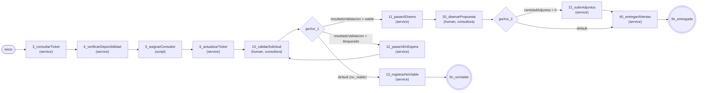

# Capa 1 — Proceso BPMN para Bonita — Gestión de Preventa

> Fuente: la reunión de socialización (`insumo-preventa/reunion-socializacion.md`) y la decisión del 2026-11-24 «Bonita-first» (`docs/08-construccion/plan-v2-bonita-first.md`), que reemplaza el alcance «solo carril del orquestador» del 12-nov. El equipo de Preventa **no vuelve a entrar a HubSpot**: la consultora asignada encuentra su tarea en Bonita, valida la solicitud y diseña la propuesta en formularios, y Bonita escribe todo en el CRM (stage, notas, propiedades del Negocio, adjuntos). El borrador del proceso completo (40 tareas) sigue archivado en `insumo-preventa/borrador-proceso-completo/`.

## Convenciones

- **IDs**: tareas `<N>_<accion>`, donde `N` es el número de la actividad del insumo (`A03` → `3_consultarTicket`); las tareas nuevas de la v2 usan `10_` (validar), `11_`/`12_` (cambios de stage tras validar) y `20_` (diseñar); compuertas `gwXor_<n>`; eventos `inicio` y `fin_*`.
- **Antes del caso**: `A01` (registrar el negocio con su MEDDPICC) y `A02` (crear el ticket) ocurren en HubSpot. El caso se instancia cuando se crea el ticket: el webhook de app `ticket.creation` llega al middleware externo, que instancia el proceso.
- **Tipo de tarea** (nombres de Bonita): `human`, `service`, `script`, `call activity`.
- **Compuertas**: `exclusive (XOR)`. Toda exclusiva declara una **salida por defecto**.
- **Salidas de compuerta**: «condición → destino» (destino entre backticks) separadas por «; », en orden de evaluación; la salida por defecto va al final con la condición «(por defecto)». La condición es el mismo texto que la columna «Condición» de la transición; su Groovy está en `docs/08-construccion/expresiones.md`.
- **Ticket y Negocio son objetos distintos de HubSpot**: Bonita mueve de stage solo el **ticket** (pipeline «Mesa de preventa»). Del **Negocio** escribe propiedades (`concepto_viabilidad`, `valoracion_operaciones`, `url_ppta_preventa`, `link_repo_preventa`), notas y adjuntos, pero no su etapa.

## Pool y lanes

### `GestionPreventa` 1.1

| Lane | Actor (actores-proceso.md) | Grupo/rol (bdm.md → Organización) | Actor Bonita | Actor filter |
|---|---|---|---|---|
| Orquestador | Orquestador | `/trycore/integracion`; rol `integracion` | `orquestador` | — |
| Consultoras | Consultora | `/trycore/preventa`; rol `consultora` | `consultora` | `filtroConsultoraDelCaso` |

**Iniciador**: `Orquestador`.

El carril Orquestador es el usuario técnico del middleware y las tareas automáticas. El carril Consultoras tiene las dos tareas humanas; el actor filter `filtroConsultoraDelCaso` hace que cada una llegue **solo** a la consultora que eligió el reparto (owner de HubSpot `ownerElegido` → usuario de Bonita, por `param_consultores`).

## Diagrama

### `GestionPreventa` 1.1

## Inventario de tareas

### `GestionPreventa` 1.1

| ID | Nombre | Tipo Bonita | Lane / actor | Fuente en §12 | Contrato (capa 2) | Conector / comunicación | Operaciones previstas | Notas |
|---|---|---|---|---|---|---|---|---|
| `3_consultarTicket` | Consultar el ticket de preventa en HubSpot | service | Orquestador | insumo `A03` | — | `conn_hubspotLeer` (síncrono) | según plantilla | Comprueba que el ticket existe y lee su asunto y el Negocio asociado |
| `4_verificarDisponibilidad` | Verificar la carga de los consultores | service | Orquestador | insumo `A04`; reunión 04:49 | — | `conn_hubspotCarga` (síncrono) | según plantilla | Suma en HubSpot la carga **ponderada por prioridad** de cada consultor de `param_consultores` en los stages «En validación» y «Asignado/En diseño» y devuelve el de menor carga (regla y pesos completos bajo la tabla de conectores) |
| `5_asignarConsultor` | Asignar consultor preventa | script | Orquestador | insumo `A05`; reunión 03:45 | — | — | según plantilla | Guarda en el caso al consultor que eligió `4_verificarDisponibilidad` |
| `6_actualizarTicket` | Actualizar estado y propietario del ticket en HubSpot | service | Orquestador | insumo `A06`; reunión 11:01 | — | `conn_hubspotActualizar` (síncrono) | según plantilla | Fija el propietario y pasa el ticket a «En validación» |
| `10_validarSolicitud` | Validar la solicitud | human | Consultoras | plan v2 paso 3; insumo `A07`, `A38` | `ctr_10_validarSolicitud` | `conn_hubspotNota` (síncrono, a la salida) | según plantilla | La consultora asignada revisa el CRM precargado y concluye viable, bloqueado o no viable; deja una nota en ticket y Negocio. El concepto lo escriben 11 o 13 |
| `11_pasarADiseno` | Pasar el ticket a «Asignado/En diseño» | service | Orquestador | plan v2 paso 3; reunión 10:15 | — | `conn_hubspotActualizar`, `conn_hubspotNegocio` (síncronos) | según plantilla | Antes la movía a mano la consultora; ahora Bonita al validar viable. Escribe también `concepto_viabilidad` en el Negocio |
| `12_pasarAEnEspera` | Pasar el ticket a «En espera información del lead» | service | Orquestador | plan v2 paso 3 | — | `conn_hubspotActualizar` (síncrono) | según plantilla | Validación bloqueada por falta de información del lead; el caso vuelve a `10_validarSolicitud` |
| `13_registrarNoViable` | Cerrar por viabilidad | service | Orquestador | plan v2 paso 3; insumo `EE4`; decisión de la usuaria, 2026-11-24 | — | `conn_hubspotNegocio`, `conn_hubspotActualizar` (síncronos) | según plantilla | Escribe `concepto_viabilidad` en el Negocio y pasa el ticket a «Closed» (`4`), «cerrado por viabilidad» |
| `20_disenarPropuesta` | Diseñar la propuesta | human | Consultoras | plan v2 paso 4; insumo `A15`–`A18` | `ctr_20_disenarPropuesta` | `conn_hubspotNegocio`, `conn_hubspotNota` (síncronos, a la salida) | según plantilla | La consultora carga los cuatro artefactos del Negocio, los adjuntos y la nota de propuesta |
| `21_subirAdjuntos` | Subir los adjuntos de la propuesta al Negocio | service | Orquestador | plan v2 paso 4 | — | `conn_hubspotArchivos` (síncrono) | según plantilla | Solo si la consultora adjuntó documentos (`gwXor_2`): el conector exige una lista no vacía |
| `40_entregarAVentas` | Cambiar estado del ticket a «Entregado a ventas» | service | Orquestador | insumo `A40`; reunión 28:22 | — | `conn_hubspotActualizar` (síncrono) | según plantilla | No cambia el propietario |

## Compuertas

### `GestionPreventa` 1.1

| ID | Tipo | Después de | Variable o atributo que decide | Salidas (condición → destino) | Salida por defecto |
|---|---|---|---|---|---|
| `gwXor_1` | exclusive (XOR) | `10_validarSolicitud` | `Preventa.resultadoValidacion` (de `ctr_10_validarSolicitud`) | resultadoValidacion = viable → `11_pasarADiseno`; resultadoValidacion = bloqueado → `12_pasarAEnEspera`; (por defecto) → `13_registrarNoViable` | `13_registrarNoViable` |
| `gwXor_2` | exclusive (XOR) | `20_disenarPropuesta` | `Preventa.cantidadAdjuntos` (de `ctr_20_disenarPropuesta`) | cantidadAdjuntos > 0 → `21_subirAdjuntos`; (por defecto) → `40_entregarAVentas` | `40_entregarAVentas` |

## Eventos

### `GestionPreventa` 1.1

| ID | Tipo | Posición (inicio / intermedio / borde de `<tarea>` / fin) | Disparador o duración | Fuente en §12 | Destino |
|---|---|---|---|---|---|
| `inicio` | none | inicio | instanciación por el actor `Orquestador` al crearse el ticket en HubSpot (`ctr_instanciacion`) | insumo `SE1`, `A01`, `A02`; reunión 08:12 | `3_consultarTicket` |
| `fin_entregada` | none | fin | — | insumo `A40` (ticket en «Entregado a ventas») | — |
| `fin_noViable` | none | fin | — | insumo `EE4` (requerimiento no viable) | — |

**Camino «no viable»** (decisión de la usuaria, 2026-11-24): **cerrado por viabilidad**. La nota de validación, que empieza por «Cerrado por viabilidad:», la deja `conn_hubspotNota` a la salida de `10_validarSolicitud` en el ticket y el Negocio; `13_registrarNoViable` escribe `concepto_viabilidad` en el Negocio y pasa el ticket a «Closed» (`param_stageCerrado` = `4`); el caso termina en `fin_noViable`.

Las tareas humanas no llevan temporizador de borde: HubSpot ya vigila los ANS del ticket.

## Transiciones

### `GestionPreventa` 1.1

| Desde | Hacia | Condición (si aplica) | Variable que la evalúa | Δestado (catalogo-estados.md) |
|---|---|---|---|---|
| `inicio` | `3_consultarTicket` | — | — | (nueva) → `recibida` |
| `3_consultarTicket` | `4_verificarDisponibilidad` | — | — | — |
| `4_verificarDisponibilidad` | `5_asignarConsultor` | — | — | — |
| `5_asignarConsultor` | `6_actualizarTicket` | — | — | `recibida` → `asignada` |
| `6_actualizarTicket` | `10_validarSolicitud` | — | — | — |
| `10_validarSolicitud` | `gwXor_1` | — | — | `asignada` o `bloqueada` → `validada`, `bloqueada` o `noViable` |
| `gwXor_1` | `11_pasarADiseno` | resultadoValidacion = viable | `Preventa.resultadoValidacion` | — |
| `gwXor_1` | `12_pasarAEnEspera` | resultadoValidacion = bloqueado | `Preventa.resultadoValidacion` | — |
| `gwXor_1` | `13_registrarNoViable` | (por defecto) | `Preventa.resultadoValidacion` | — |
| `13_registrarNoViable` | `fin_noViable` | — | — | — |
| `11_pasarADiseno` | `20_disenarPropuesta` | — | — | — |
| `12_pasarAEnEspera` | `10_validarSolicitud` | — | — | — |
| `20_disenarPropuesta` | `gwXor_2` | — | — | `validada` → `propuestaDisenada` |
| `gwXor_2` | `21_subirAdjuntos` | cantidadAdjuntos > 0 | `Preventa.cantidadAdjuntos` | — |
| `gwXor_2` | `40_entregarAVentas` | (por defecto) | `Preventa.cantidadAdjuntos` | — |
| `21_subirAdjuntos` | `40_entregarAVentas` | — | — | — |
| `40_entregarAVentas` | `fin_entregada` | — | — | `propuestaDisenada` → `entregadaAVentas` |

## Conectores por tarea

### `GestionPreventa` 1.1

| Tarea | Conector (catalogo-conectores.md) | Modo | Momento (entrada / salida de la tarea) | Entrada (process variable o atributo) | Salida (destino) | Manejo de fallo |
|---|---|---|---|---|---|---|
| `3_consultarTicket` | `conn_hubspotLeer` (propio `hubspot-ticket-leer`) | síncrono | entrada | `urlBase` ← `la dirección base de la API de HubSpot del entorno` (`conn_hubspotLeer.3_consultarTicket.urlBase`); `rutaTickets` ← `la ruta de tickets de la API de HubSpot del entorno` (`conn_hubspotLeer.3_consultarTicket.rutaTickets`); `ticketId` ← `el identificador del ticket del caso` (`conn_hubspotLeer.3_consultarTicket.ticketId`) | `Preventa.asunto` ← `asunto`; `Preventa.dealId` ← `dealId` | la tarea queda en fallo (comportamiento por defecto de Bonita) y se reintenta desde la administración |
| `4_verificarDisponibilidad` | `conn_hubspotCarga` (propio `hubspot-consultores-menor-carga`) | síncrono | entrada | `urlBase` ← `la dirección base de la API de HubSpot del entorno` (`conn_hubspotCarga.4_verificarDisponibilidad.urlBase`); `rutaTickets` ← `la ruta de tickets de la API de HubSpot del entorno` (`conn_hubspotCarga.4_verificarDisponibilidad.rutaTickets`); `pipelineId` ← `el pipeline de tickets del entorno` (`conn_hubspotCarga.4_verificarDisponibilidad.pipelineId`); `ownerIds` ← `los owners de param_consultores, en su orden, separados por coma` (`conn_hubspotCarga.4_verificarDisponibilidad.ownerIds`); `stages` ← `los stages En validación y Asignado/En diseño del entorno, separados por coma` (`conn_hubspotCarga.4_verificarDisponibilidad.stages`); `ultimoOwnerId` ← `el owner del consultor del caso asignado más recientemente según la consulta findAsignadasRecientes, o vacío si no hay ninguno` (`conn_hubspotCarga.4_verificarDisponibilidad.ultimoOwnerId`) | `pv ownerElegido` ← `ownerElegido` | la tarea queda en fallo (comportamiento por defecto de Bonita) y se reintenta desde la administración |
| `6_actualizarTicket` | `conn_hubspotActualizar` (propio `hubspot-ticket-actualizar`) | síncrono | entrada | `urlBase` ← `la dirección base de la API de HubSpot del entorno` (`conn_hubspotActualizar.6_actualizarTicket.urlBase`); `rutaTickets` ← `la ruta de tickets de la API de HubSpot del entorno` (`conn_hubspotActualizar.6_actualizarTicket.rutaTickets`); `ticketId` ← `el identificador del ticket del caso` (`conn_hubspotActualizar.6_actualizarTicket.ticketId`); `stageId` ← `el stage En validación del entorno` (`conn_hubspotActualizar.6_actualizarTicket.stageId`); `ownerId` ← `el owner de HubSpot del consultor asignado` (`conn_hubspotActualizar.6_actualizarTicket.ownerId`) | — | la tarea queda en fallo (comportamiento por defecto de Bonita) y se reintenta desde la administración |
| `10_validarSolicitud` | `conn_hubspotNota` (propio `hubspot-nota-crear`) | síncrono | salida | `urlBase` ← `la dirección base de la API de HubSpot del entorno` (`conn_hubspotNota.10_validarSolicitud.urlBase`); `cuerpo` ← `el resultado, el concepto, la nota y los supuestos de la validación; si es no viable empieza por Cerrado por viabilidad:` (`conn_hubspotNota.10_validarSolicitud.cuerpo`); `ticketId` ← `el identificador del ticket del caso` (`conn_hubspotNota.10_validarSolicitud.ticketId`); `dealId` ← `el Negocio asociado al ticket del caso` (`conn_hubspotNota.10_validarSolicitud.dealId`) | — | la tarea queda en fallo (comportamiento por defecto de Bonita) y se reintenta desde la administración |
| `11_pasarADiseno` | `conn_hubspotActualizar` (propio `hubspot-ticket-actualizar`) | síncrono | entrada | `urlBase` ← `la dirección base de la API de HubSpot del entorno` (`conn_hubspotActualizar.11_pasarADiseno.urlBase`); `rutaTickets` ← `la ruta de tickets de la API de HubSpot del entorno` (`conn_hubspotActualizar.11_pasarADiseno.rutaTickets`); `ticketId` ← `el identificador del ticket del caso` (`conn_hubspotActualizar.11_pasarADiseno.ticketId`); `stageId` ← `el stage Asignado/En diseño del entorno` (`conn_hubspotActualizar.11_pasarADiseno.stageId`); `ownerId` ← `vacío, no cambia el propietario` (`conn_hubspotActualizar.11_pasarADiseno.ownerId`) | — | la tarea queda en fallo (comportamiento por defecto de Bonita) y se reintenta desde la administración |
| `11_pasarADiseno` | `conn_hubspotNegocio` (propio `hubspot-negocio-actualizar`) | síncrono | salida | `urlBase` ← `la dirección base de la API de HubSpot del entorno` (`conn_hubspotNegocio.11_pasarADiseno.urlBase`); `dealId` ← `el Negocio asociado al ticket del caso` (`conn_hubspotNegocio.11_pasarADiseno.dealId`); `propiedadesJson` ← `el concepto de viabilidad como propiedad concepto_viabilidad, en JSON` (`conn_hubspotNegocio.11_pasarADiseno.propiedadesJson`) | — | la tarea queda en fallo (comportamiento por defecto de Bonita) y se reintenta desde la administración |
| `12_pasarAEnEspera` | `conn_hubspotActualizar` (propio `hubspot-ticket-actualizar`) | síncrono | entrada | `urlBase` ← `la dirección base de la API de HubSpot del entorno` (`conn_hubspotActualizar.12_pasarAEnEspera.urlBase`); `rutaTickets` ← `la ruta de tickets de la API de HubSpot del entorno` (`conn_hubspotActualizar.12_pasarAEnEspera.rutaTickets`); `ticketId` ← `el identificador del ticket del caso` (`conn_hubspotActualizar.12_pasarAEnEspera.ticketId`); `stageId` ← `el stage En espera información del lead del entorno` (`conn_hubspotActualizar.12_pasarAEnEspera.stageId`); `ownerId` ← `vacío, no cambia el propietario` (`conn_hubspotActualizar.12_pasarAEnEspera.ownerId`) | — | la tarea queda en fallo (comportamiento por defecto de Bonita) y se reintenta desde la administración |
| `13_registrarNoViable` | `conn_hubspotNegocio` (propio `hubspot-negocio-actualizar`) | síncrono | salida | `urlBase` ← `la dirección base de la API de HubSpot del entorno` (`conn_hubspotNegocio.13_registrarNoViable.urlBase`); `dealId` ← `el Negocio asociado al ticket del caso` (`conn_hubspotNegocio.13_registrarNoViable.dealId`); `propiedadesJson` ← `el concepto de viabilidad como propiedad concepto_viabilidad, en JSON` (`conn_hubspotNegocio.13_registrarNoViable.propiedadesJson`) | — | la tarea queda en fallo (comportamiento por defecto de Bonita) y se reintenta desde la administración |
| `13_registrarNoViable` | `conn_hubspotActualizar` (propio `hubspot-ticket-actualizar`) | síncrono | entrada | `urlBase` ← `la dirección base de la API de HubSpot del entorno` (`conn_hubspotActualizar.13_registrarNoViable.urlBase`); `rutaTickets` ← `la ruta de tickets de la API de HubSpot del entorno` (`conn_hubspotActualizar.13_registrarNoViable.rutaTickets`); `ticketId` ← `el identificador del ticket del caso` (`conn_hubspotActualizar.13_registrarNoViable.ticketId`); `stageId` ← `el stage Closed del entorno` (`conn_hubspotActualizar.13_registrarNoViable.stageId`); `ownerId` ← `vacío, no cambia el propietario` (`conn_hubspotActualizar.13_registrarNoViable.ownerId`) | — | la tarea queda en fallo (comportamiento por defecto de Bonita) y se reintenta desde la administración |
| `20_disenarPropuesta` | `conn_hubspotNegocio` (propio `hubspot-negocio-actualizar`) | síncrono | salida | `urlBase` ← `la dirección base de la API de HubSpot del entorno` (`conn_hubspotNegocio.20_disenarPropuesta.urlBase`); `dealId` ← `el Negocio asociado al ticket del caso` (`conn_hubspotNegocio.20_disenarPropuesta.dealId`); `propiedadesJson` ← `las cuatro propiedades de artefactos del Negocio, en JSON` (`conn_hubspotNegocio.20_disenarPropuesta.propiedadesJson`) | — | la tarea queda en fallo (comportamiento por defecto de Bonita) y se reintenta desde la administración |
| `20_disenarPropuesta` | `conn_hubspotNota` (propio `hubspot-nota-crear`) | síncrono | salida | `urlBase` ← `la dirección base de la API de HubSpot del entorno` (`conn_hubspotNota.20_disenarPropuesta.urlBase`); `cuerpo` ← `la nota de la propuesta con los enlaces de los artefactos` (`conn_hubspotNota.20_disenarPropuesta.cuerpo`); `ticketId` ← `el identificador del ticket del caso` (`conn_hubspotNota.20_disenarPropuesta.ticketId`); `dealId` ← `el Negocio asociado al ticket del caso` (`conn_hubspotNota.20_disenarPropuesta.dealId`) | — | la tarea queda en fallo (comportamiento por defecto de Bonita) y se reintenta desde la administración |
| `21_subirAdjuntos` | `conn_hubspotArchivos` (propio `hubspot-archivo-subir`) | síncrono | entrada | `urlBase` ← `la dirección base de la API de HubSpot del entorno` (`conn_hubspotArchivos.21_subirAdjuntos.urlBase`); `documentos` ← `los adjuntos de la propuesta del caso` (`conn_hubspotArchivos.21_subirAdjuntos.documentos`); `dealId` ← `el Negocio asociado al ticket del caso` (`conn_hubspotArchivos.21_subirAdjuntos.dealId`); `ticketId` ← `el identificador del ticket del caso` (`conn_hubspotArchivos.21_subirAdjuntos.ticketId`) | — | la tarea queda en fallo (comportamiento por defecto de Bonita) y se reintenta desde la administración |
| `40_entregarAVentas` | `conn_hubspotActualizar` (propio `hubspot-ticket-actualizar`) | síncrono | entrada | `urlBase` ← `la dirección base de la API de HubSpot del entorno` (`conn_hubspotActualizar.40_entregarAVentas.urlBase`); `rutaTickets` ← `la ruta de tickets de la API de HubSpot del entorno` (`conn_hubspotActualizar.40_entregarAVentas.rutaTickets`); `ticketId` ← `el identificador del ticket del caso` (`conn_hubspotActualizar.40_entregarAVentas.ticketId`); `stageId` ← `el stage Entregado a ventas del entorno` (`conn_hubspotActualizar.40_entregarAVentas.stageId`); `ownerId` ← `vacío, no cambia el propietario` (`conn_hubspotActualizar.40_entregarAVentas.ownerId`) | — | la tarea queda en fallo (comportamiento por defecto de Bonita) y se reintenta desde la administración |

Los seis conectores son **propios** del proyecto (`bonita-project/extensions/preventa-conectores`): REST nativo de Bonita hacia HubSpot; no se usa el conector oficial Bonita–HubSpot (Beta, sin tickets). `hubspot-negocio-actualizar`, `hubspot-nota-crear` y `hubspot-archivo-subir` (y la salida `dealId` de `hubspot-ticket-leer`) los implementa otra unidad de trabajo (ver `docs/08-construccion/conectores-escritura-hubspot.md`). El token de la Private App **no es una entrada**: la implementación lo lee de la variable de entorno `HUBSPOT_PRIVATE_APP_TOKEN`. En «Salida (destino)», la parte derecha de cada `←` es la salida del conector.

**Conectores condicionales**: `hubspot-negocio-actualizar` exige propiedades no vacías y `hubspot-archivo-subir` una lista de documentos no vacía, y un conector de Bonita no se salta por condición; por eso el concepto de viabilidad se escribe en las ramas `11_pasarADiseno` / `13_registrarNoViable` (no con «bloqueado») y los adjuntos en `21_subirAdjuntos` solo si los hay (`gwXor_2`).

**Conectores a la salida de una tarea humana**: corren al terminar la tarea, con los inputs del contrato y las operaciones ya aplicadas `[no verificado]` (orden contrato → operaciones → conectores de salida); por eso sus entradas leen los atributos de `preventa` que la tarea acaba de escribir. Si un conector falla, la tarea queda en fallo y lo ya enviado a HubSpot por los anteriores **no se deshace** (p. ej. adjuntos subidos sin nota): reintentar desde la administración puede duplicar notas o adjuntos.

**Regla de `conn_hubspotCarga`** (toda la decisión de a quién asignar vive en este conector, para que se pruebe en un solo sitio):

1. Candidatos: los owners de `ownerIds`, en ese orden. Si la lista está vacía, el conector falla con el mensaje «no hay consultores en el reparto» y la tarea queda en fallo. `param_consultores` se lee quitando espacios; una entrada sin «:», con owner vacío o con un owner repetido hace fallar la tarea con el mensaje «param_consultores mal formado».
2. Carga de cada candidato: **suma ponderada por prioridad** de los tickets del pipeline `pipelineId` («Mesa de preventa») cuyo propietario es ese owner y cuyo stage es uno de `stages` (búsqueda de tickets de HubSpot). No es el conteo simple: así la carga mide **capacidad** (más tickets suman más) **y prioridad** (un ticket de mayor prioridad pesa más) a la vez. El peso se lee de `hs_ticket_priority`:

   | `hs_ticket_priority` | Peso |
   |---|---|
   | `URGENT` | 4 |
   | `HIGH` | 3 |
   | `MEDIUM` | 2 |
   | `LOW` | 1 |
   | vacío / desconocido | 2 (como `MEDIUM`) |

   Cuando todos los tickets tienen la misma prioridad, la suma equivale al conteo (reparte por capacidad). Verificado: conteo en vivo el 2026-11-12; ponderación en vivo el 2026-11-19 (Linda HIGH+URGENT = 7 vs Viviana HIGH+LOW+LOW = 5 → el nuevo ticket va a Viviana, aunque tenga más tickets, porque su carga ponderada es menor; contar habría elegido a Linda).
3. Si un solo candidato tiene la carga mínima, ese es `ownerElegido`.
4. Si varios empatan en la mínima: si `ultimoOwnerId` está vacío o no es un candidato, gana el primero de los empatados en el orden de `ownerIds`; si no, gana el primer empatado que aparece después de `ultimoOwnerId` recorriendo `ownerIds` de forma circular.

**`conn_hubspotActualizar`**: un `ownerId` vacío significa «no enviar `hubspot_owner_id`» (no se borra el propietario). En `6_actualizarTicket` el propietario es obligatorio: si el caso no tiene consultor, la expresión de `ownerId` falla y la tarea queda en fallo, en lugar de dejar el ticket en «En validación» sin propietario.

**Sin bloqueo**: si se crean dos tickets a la vez, los dos casos pueden leer la misma carga y asignar a la misma consultora. Es consecuencia aceptada de la decisión «sin bloqueo transaccional». El último asignado no se guarda en un contador: se lee del caso más reciente que ya tiene consultor.

### Mapa estado del ticket (pipeline «Mesa de preventa», id `0`)

| Stage del ticket | `stageId` | Quién lo pone | Cómo |
|---|---|---|---|
| Solicitud recibida | `1` | HubSpot, al crear el comercial el ticket | — (dispara el caso) |
| En validación | `2` | **Bonita**, `6_actualizarTicket`, junto con el propietario | automático (`param_stageEnValidacion`) |
| Asignado/En diseño | `3` | **Bonita**, `11_pasarADiseno` | al validar «viable» (`param_stageEnDiseno`) |
| En espera información del lead | `1425810257` | **Bonita**, `12_pasarAEnEspera` | al validar «bloqueado» (`param_stageEnEspera`) |
| Entregado a ventas | `1425810258` | **Bonita**, `40_entregarAVentas` | al terminar `20_disenarPropuesta` (`param_stageEntregado`) |
| Closed | `4` | el comercial; **Bonita**, `13_registrarNoViable` | manual (reunión 39:22); automático al validar «no viable» (`param_stageCerrado`, decisión de la usuaria, 2026-11-24) |

«No viable» cierra el ticket (decisión de la usuaria, 2026-11-24). Los stages 2 y 3 son además la medida de carga de `4_verificarDisponibilidad` («En espera información del lead» no cuenta, está bloqueado por el lead).

## Process variables (insumo de construcción)

### `GestionPreventa` 1.1

| Variable | Tipo | Valor por defecto | Transitoria | Justificación (compuerta, conector o transición que la necesita) |
|---|---|---|---|---|
| `ownerElegido` | TEXT | — | no | salida de `conn_hubspotCarga`; la leen `5_asignarConsultor` y el actor filter `filtroConsultoraDelCaso` |

## Documentos del proceso

### `GestionPreventa` 1.1

| Documento | Múltiple | Tarea que lo aporta | Tareas que lo leen | Fuente en §12 |
|---|---|---|---|---|
| `adjuntosPropuesta` | sí | `20_disenarPropuesta` | `21_subirAdjuntos` (`conn_hubspotArchivos`, que los sube al Negocio en HubSpot) | plan v2 paso 4 (adjuntos) |

## Verificaciones de diseño (las revisa el gate)

- [x] Toda actividad del carril del orquestador del insumo tiene fila en el inventario (`A03`, `A04`, `A05`, `A06`, `A40`), más las tareas de la v2 (`10`, `11`, `12`, `13`, `20`, `21`).
- [x] Ninguna lane con dos tareas humanas consecutivas (`10` y `20` están separadas por `gwXor_1` y `11_pasarADiseno`).
- [x] Toda compuerta con todas sus salidas y una por defecto.
- [x] Toda transición condicional nombra la variable que la evalúa.
- [x] Toda tarea humana tiene su `ctr_*` reservado.
- [x] Toda tarea de servicio cita un conector con su modo.

## Pendientes de definición

- **Empate de carga**: la reunión no dice a quién asignar si las dos consultoras tienen la misma carga. Se documenta la regla del punto 4 de `conn_hubspotCarga` (alternar). Requiere confirmación de negocio.
- **Ticket ya asignado a mano**: si alguien asigna el ticket en HubSpot antes de que corra el caso, Bonita lo reasigna igual. La reunión no lo trata.
- **Ticket con varios Negocios**: `hubspot-ticket-leer` toma el primero asociado; si no hay ninguno, `dealId` queda vacío y los conectores del Negocio dejan la tarea en fallo `[no verificado]`.
- **Ticket sin Negocio asociado**: `dealId` vacío. Los conectores de Negocio, nota y archivos deben decidir qué hacer (omitir el Negocio y escribir solo en el ticket); lo define su implementación `[no verificado]`.
- **Reintentos de conectores de salida**: reintentar una tarea humana en fallo puede duplicar notas o adjuntos en HubSpot (ver la nota bajo la tabla de conectores).
- **Ticket cerrado en HubSpot con el caso abierto**: si el comercial cierra el ticket mientras la tarea está en Bonita, nada lo detecta (antes lo avisaba el middleware a la tarea de espera, retirada en la v2). Lo detectaría la reconciliación, que todavía no existe.
- **Versión de la API de HubSpot**: `/crm/v3/objects/tickets` y `/crm/objects/2026-09/tickets` respondieron 200 el 2026-11-12. Se usa la primera; la ruta es parámetro.
- **Job de reconciliación diaria** Bonita vs HubSpot (arquitectura acordada el 2026-11-11): sigue sin decidirse dónde vive.
