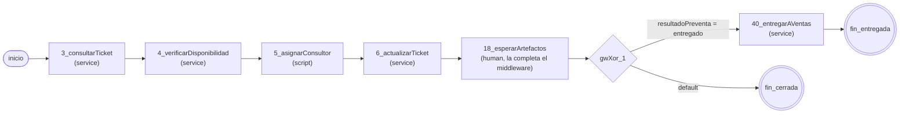

# Capa 1 — Proceso BPMN para Bonita — Gestión de Preventa

> Fuente: la reunión de socialización (`insumo-preventa/reunion-socializacion.md`) y el carril «Orquestador Ofelia + HubSpot» del BPMN del insumo. La reunión fija el alcance: Bonita automatiza **solo** ese carril (`A03`–`A06` y `A40`). Las otras 35 actividades del insumo las hacen personas en HubSpot y no son tareas de este pool. El borrador del proceso completo (40 tareas) queda archivado en `insumo-preventa/borrador-proceso-completo/`.

## Convenciones

- **IDs**: tareas `<N>_<accion>`, donde `N` es el número de la actividad del insumo (`A03` → `3_consultarTicket`); compuertas `gwXor_<n>`; eventos `inicio` y `fin_*`.
- **Antes del caso**: `A01` (registrar el negocio con su MEDDPICC) y `A02` (crear el ticket) ocurren en HubSpot. El caso se instancia cuando se crea el ticket: un Workflow nativo de HubSpot (Sales Hub Pro) dispara un webhook que el middleware externo convierte en una instanciación de proceso.
- **Tipo de tarea** (nombres de Bonita): `human`, `service`, `script`, `call activity`.
- **Compuertas**: `exclusive (XOR)`. Toda exclusiva declara una **salida por defecto**.
- **Salidas de compuerta**: «condición → destino» (destino entre backticks) separadas por «; », en orden de evaluación; la salida por defecto va al final con la condición «(por defecto)». La condición es el mismo texto que la columna «Condición» de la transición; su Groovy está en `docs/08-construccion/expresiones.md`.
- **Ticket y negocio son objetos distintos de HubSpot**: Bonita solo escribe el **ticket** (pipeline «Mesa de preventa»). El negocio no se mueve de etapa (reunión, 32:08).

## Pool y lanes

### `GestionPreventa` 1.0

| Lane | Actor (actores-proceso.md) | Grupo/rol (bdm.md → Organización) | Actor Bonita | Actor filter |
|---|---|---|---|---|
| Orquestador | Orquestador | `/trycore/integracion`; rol `integracion` | `orquestador` | — |

**Iniciador**: `Orquestador`.

Un solo carril: el «Orquestador Ofelia + HubSpot» del insumo. Su actor es el usuario técnico del middleware. Los otros seis carriles del insumo (Cliente, Comercial, Consultor Preventa, Líder Técnico, Agente IA, Equipo interno) no tienen tareas en Bonita.

## Diagrama

### `GestionPreventa` 1.0

## Inventario de tareas

### `GestionPreventa` 1.0

| ID | Nombre | Tipo Bonita | Lane / actor | Fuente en §12 | Contrato (capa 2) | Conector / comunicación | Operaciones previstas | Notas |
|---|---|---|---|---|---|---|---|---|
| `3_consultarTicket` | Consultar el ticket de preventa en HubSpot | service | Orquestador | insumo `A03` | — | `conn_hubspotLeer` (síncrono) | según plantilla | Comprueba que el ticket existe y lee su asunto |
| `4_verificarDisponibilidad` | Verificar la carga de los consultores | service | Orquestador | insumo `A04`; reunión 04:49 | — | `conn_hubspotCarga` (síncrono) | según plantilla | Suma en HubSpot la carga **ponderada por prioridad** de cada consultor de `param_consultores` en los stages «En validación» y «Asignado/En diseño» y devuelve el de menor carga (regla y pesos completos bajo la tabla de conectores) |
| `5_asignarConsultor` | Asignar consultor preventa | script | Orquestador | insumo `A05`; reunión 03:45 | — | — | según plantilla | Guarda en el caso al consultor que eligió `4_verificarDisponibilidad` |
| `6_actualizarTicket` | Actualizar estado y propietario del ticket en HubSpot | service | Orquestador | insumo `A06`; reunión 11:01 | — | `conn_hubspotActualizar` (síncrono) | según plantilla | Fija el propietario y pasa el ticket a «En validación» |
| `18_esperarArtefactos` | Esperar la carga de artefactos en el negocio | human | Orquestador | insumo `A18`; reunión 28:22 | `ctr_18_esperarArtefactos` | — | según plantilla | Tarea añadida por el diseño (en el insumo `A18` la hace la consultora en HubSpot, no el orquestador). No la abre una persona: la completa el middleware por la API cuando HubSpot avisa. Es la espera del caso. Sin temporizador a propósito (nota bajo Eventos) |
| `40_entregarAVentas` | Cambiar estado del ticket a «Entregado a ventas» | service | Orquestador | insumo `A40`; reunión 28:22 | — | `conn_hubspotActualizar` (síncrono) | según plantilla | No cambia el propietario |

## Compuertas

### `GestionPreventa` 1.0

| ID | Tipo | Después de | Variable o atributo que decide | Salidas (condición → destino) | Salida por defecto |
|---|---|---|---|---|---|
| `gwXor_1` | exclusive (XOR) | `18_esperarArtefactos` | `resultadoPreventa` (process variable, de `ctr_18_esperarArtefactos`) | resultadoPreventa = entregado → `40_entregarAVentas`; (por defecto) → `fin_cerrada` | `fin_cerrada` |

## Eventos

### `GestionPreventa` 1.0

| ID | Tipo | Posición (inicio / intermedio / borde de `<tarea>` / fin) | Disparador o duración | Fuente en §12 | Destino |
|---|---|---|---|---|---|
| `inicio` | none | inicio | instanciación por el actor `Orquestador` al crearse el ticket en HubSpot (`ctr_instanciacion`) | insumo `SE1`, `A01`, `A02`; reunión 08:12 | `3_consultarTicket` |
| `fin_entregada` | none | fin | — | insumo `A40` (ticket en «Entregado a ventas») | — |
| `fin_cerrada` | none | fin | — | insumo `EE1` y `EE4` (el ticket se cierra sin entregar a ventas: demo descartada o requerimiento no viable) | — |

`18_esperarArtefactos` no lleva temporizador de borde: el tiempo entre asignar y entregar no tiene tope de negocio (HubSpot ya vigila los ANS del ticket y avisa de los vencimientos). Un caso solo termina cuando el middleware informa `entregado` o `cerrado`; los que queden abiertos por un aviso perdido los detectaría la reconciliación, que todavía no existe (ver Pendientes): hoy nada los detecta.

## Transiciones

### `GestionPreventa` 1.0

| Desde | Hacia | Condición (si aplica) | Variable que la evalúa | Δestado (catalogo-estados.md) |
|---|---|---|---|---|
| `inicio` | `3_consultarTicket` | — | — | (nueva) → `recibida` |
| `3_consultarTicket` | `4_verificarDisponibilidad` | — | — | — |
| `4_verificarDisponibilidad` | `5_asignarConsultor` | — | — | — |
| `5_asignarConsultor` | `6_actualizarTicket` | — | — | `recibida` → `asignada` |
| `6_actualizarTicket` | `18_esperarArtefactos` | — | — | — |
| `18_esperarArtefactos` | `gwXor_1` | — | — | `asignada` → `artefactosCargados` o `cerrada` |
| `gwXor_1` | `40_entregarAVentas` | resultadoPreventa = entregado | `resultadoPreventa` | — |
| `gwXor_1` | `fin_cerrada` | (por defecto) | `resultadoPreventa` | — |
| `40_entregarAVentas` | `fin_entregada` | — | — | `artefactosCargados` → `entregadaAVentas` |

## Conectores por tarea

### `GestionPreventa` 1.0

| Tarea | Conector (catalogo-conectores.md) | Modo | Momento (entrada / salida de la tarea) | Entrada (process variable o atributo) | Salida (destino) | Manejo de fallo |
|---|---|---|---|---|---|---|
| `3_consultarTicket` | `conn_hubspotLeer` (propio `hubspot-ticket-leer`) | síncrono | entrada | `urlBase` ← `la dirección base de la API de HubSpot del entorno` (`conn_hubspotLeer.3_consultarTicket.urlBase`); `rutaTickets` ← `la ruta de tickets de la API de HubSpot del entorno` (`conn_hubspotLeer.3_consultarTicket.rutaTickets`); `ticketId` ← `el identificador del ticket del caso` (`conn_hubspotLeer.3_consultarTicket.ticketId`) | `Preventa.asunto` ← `asunto` | la tarea queda en fallo (comportamiento por defecto de Bonita) y se reintenta desde la administración |
| `4_verificarDisponibilidad` | `conn_hubspotCarga` (propio `hubspot-consultores-menor-carga`) | síncrono | entrada | `urlBase` ← `la dirección base de la API de HubSpot del entorno` (`conn_hubspotCarga.4_verificarDisponibilidad.urlBase`); `rutaTickets` ← `la ruta de tickets de la API de HubSpot del entorno` (`conn_hubspotCarga.4_verificarDisponibilidad.rutaTickets`); `pipelineId` ← `el pipeline de tickets del entorno` (`conn_hubspotCarga.4_verificarDisponibilidad.pipelineId`); `ownerIds` ← `los owners de param_consultores, en su orden, separados por coma` (`conn_hubspotCarga.4_verificarDisponibilidad.ownerIds`); `stages` ← `los stages En validación y Asignado/En diseño del entorno, separados por coma` (`conn_hubspotCarga.4_verificarDisponibilidad.stages`); `ultimoOwnerId` ← `el owner del consultor del caso asignado más recientemente según la consulta findAsignadasRecientes, o vacío si no hay ninguno` (`conn_hubspotCarga.4_verificarDisponibilidad.ultimoOwnerId`) | `pv ownerElegido` ← `ownerElegido` | la tarea queda en fallo (comportamiento por defecto de Bonita) y se reintenta desde la administración |
| `6_actualizarTicket` | `conn_hubspotActualizar` (propio `hubspot-ticket-actualizar`) | síncrono | entrada | `urlBase` ← `la dirección base de la API de HubSpot del entorno` (`conn_hubspotActualizar.6_actualizarTicket.urlBase`); `rutaTickets` ← `la ruta de tickets de la API de HubSpot del entorno` (`conn_hubspotActualizar.6_actualizarTicket.rutaTickets`); `ticketId` ← `el identificador del ticket del caso` (`conn_hubspotActualizar.6_actualizarTicket.ticketId`); `stageId` ← `el stage En validación del entorno` (`conn_hubspotActualizar.6_actualizarTicket.stageId`); `ownerId` ← `el owner de HubSpot del consultor asignado` (`conn_hubspotActualizar.6_actualizarTicket.ownerId`) | — | la tarea queda en fallo (comportamiento por defecto de Bonita) y se reintenta desde la administración |
| `40_entregarAVentas` | `conn_hubspotActualizar` (propio `hubspot-ticket-actualizar`) | síncrono | entrada | `urlBase` ← `la dirección base de la API de HubSpot del entorno` (`conn_hubspotActualizar.40_entregarAVentas.urlBase`); `rutaTickets` ← `la ruta de tickets de la API de HubSpot del entorno` (`conn_hubspotActualizar.40_entregarAVentas.rutaTickets`); `ticketId` ← `el identificador del ticket del caso` (`conn_hubspotActualizar.40_entregarAVentas.ticketId`); `stageId` ← `el stage Entregado a ventas del entorno` (`conn_hubspotActualizar.40_entregarAVentas.stageId`); `ownerId` ← `vacío, no cambia el propietario` (`conn_hubspotActualizar.40_entregarAVentas.ownerId`) | — | la tarea queda en fallo (comportamiento por defecto de Bonita) y se reintenta desde la administración |

Los tres conectores son **propios** del proyecto (`bonita-project/extensions/preventa-conectores`): REST nativo de Bonita hacia HubSpot; no se usa el conector oficial Bonita–HubSpot (Beta, sin tickets). El token de la Private App **no es una entrada**: la implementación lo lee de la variable de entorno `HUBSPOT_PRIVATE_APP_TOKEN`. En «Salida (destino)», la parte derecha de cada `←` es la salida del conector.

**Regla de `conn_hubspotCarga`** (toda la decisión de a quién asignar vive en este conector, para que se pruebe en un solo sitio):

1. Candidatos: los owners de `ownerIds`, en ese orden. Si la lista está vacía, el conector falla con el mensaje «no hay consultores en el reparto» y la tarea queda en fallo. `param_consultores` se lee quitando espacios; un par sin «:», con owner vacío o con un owner repetido hace fallar la tarea con el mensaje «param_consultores mal formado».
2. Carga de cada candidato: **suma ponderada por prioridad** de los tickets del pipeline `pipelineId` («Mesa de preventa») cuyo propietario es ese owner y cuyo stage es uno de `stages` (búsqueda de tickets de HubSpot). No es el conteo simple: así la carga mide **capacidad** (más tickets suman más) **y prioridad** (un ticket de mayor prioridad pesa más) a la vez. El peso se lee de `hs_ticket_priority`:

   | `hs_ticket_priority` | Peso |
   |---|---|
   | `URGENT` | 4 |
   | `HIGH` | 3 |
   | `MEDIUM` | 2 |
   | `LOW` | 1 |
   | vacío / desconocido | 2 (como `MEDIUM`) |

   Cuando todos los tickets tienen la misma prioridad, la suma equivale al conteo (reparte por capacidad). Verificado: conteo en vivo el 2026-11-12; ponderación en vivo el 2026-11-19 (Linda HIGH+URGENT = 7 vs Viviana HIGH+LOW+LOW = 5 → el nuevo ticket va a Viviana, aunque tenga más tickets, porque su carga ponderada es menor; contar habría elegido a Linda).
3. Si un solo candidato tiene la carga mínima, ese es `ownerElegido`.
4. Si varios empatan en la mínima: si `ultimoOwnerId` está vacío o no es un candidato, gana el primero de los empatados en el orden de `ownerIds`; si no, gana el primer empatado que aparece después de `ultimoOwnerId` recorriendo `ownerIds` de forma circular.

**`conn_hubspotActualizar`**: un `ownerId` vacío significa «no enviar `hubspot_owner_id`» (no se borra el propietario). En `6_actualizarTicket` el propietario es obligatorio: si el caso no tiene consultor, la expresión de `ownerId` falla y la tarea queda en fallo, en lugar de dejar el ticket en «En validación» sin propietario.

**Sin bloqueo**: si se crean dos tickets a la vez, los dos casos pueden leer la misma carga y asignar a la misma consultora. Es consecuencia aceptada de la decisión «sin bloqueo transaccional». El último asignado no se guarda en un contador: se lee del caso más reciente que ya tiene consultor.

### Mapa estado del ticket (pipeline «Mesa de preventa», id `0`)

| Stage del ticket | `stageId` | Quién lo pone | Cómo |
|---|---|---|---|
| Solicitud recibida | `1` | HubSpot, al crear el comercial el ticket | — (dispara el caso) |
| En validación | `2` | **Bonita**, `6_actualizarTicket`, junto con el propietario | automático (`param_stageEnValidacion`) |
| Asignado/En diseño | `3` | la consultora | manual (reunión 10:15) |
| En espera información del lead | `1425810257` | la consultora | manual |
| Entregado a ventas | `1425810258` | **Bonita**, `40_entregarAVentas` | automático al cargarse los artefactos en el negocio (`param_stageEntregado`) |
| Closed | `4` | el comercial | manual (reunión 39:22) |

Bonita escribe el ticket dos veces por caso. Los stages 2 y 3 son además la medida de carga de `4_verificarDisponibilidad` (ponderada por prioridad; «En espera información del lead» no cuenta, está bloqueado por el lead).

## Process variables (insumo de construcción)

### `GestionPreventa` 1.0

| Variable | Tipo | Valor por defecto | Transitoria | Justificación (compuerta, conector o transición que la necesita) |
|---|---|---|---|---|
| `ownerElegido` | TEXT | — | no | salida de `conn_hubspotCarga`; la lee `5_asignarConsultor` |
| `resultadoPreventa` | TEXT | — | no | `gwXor_1` (destino del input `resultado` de `ctr_18_esperarArtefactos`) |

## Documentos del proceso

### `GestionPreventa` 1.0

| Documento | Múltiple | Tarea que lo aporta | Tareas que lo leen | Fuente en §12 |
|---|---|---|---|---|
| — | — | — | — | — |

## Verificaciones de diseño (las revisa el gate)

- [x] Toda actividad del carril del orquestador del insumo tiene fila en el inventario (`A03`, `A04`, `A05`, `A06`, `A40`), más la espera `18_esperarArtefactos`.
- [x] Ninguna lane con dos tareas humanas consecutivas (solo hay una tarea humana).
- [x] Toda compuerta con todas sus salidas y una por defecto.
- [x] Toda transición condicional nombra la variable que la evalúa.
- [x] Toda tarea humana tiene su `ctr_*` reservado.
- [x] Toda tarea de servicio cita un conector con su modo.

## Pendientes de definición

- **Empate de carga**: la reunión no dice a quién asignar si las dos consultoras tienen la misma cantidad de tickets. Se documenta la regla del punto 4 de `conn_hubspotCarga` (alternar). Requiere confirmación de negocio.
- **Prioridad y ANS**: no se usan en la asignación (la reunión los menciona sin decidir, 06:08).
- **Ticket ya asignado a mano**: si alguien asigna el ticket en HubSpot antes de que corra el caso, Bonita lo reasigna igual. La reunión no lo trata.
- **Cuándo están «cargados» los artefactos** (confirmado por negocio, 2026-11-13): son cuatro propiedades del negocio asociado al ticket, verificadas en vivo el 2026-11-12: `concepto_viabilidad` (Concepto viabilidad por Preventa), `estimacion_costos` (Estimación fábrica), `url_ppta_preventa` (URL propuesta Preventa - Slide) y `link_repo_preventa` (Link repositorio Preventa). Las completa comercial. Basta con que las cuatro tengan algún valor (no vacías) para que el caso continúe. Un Workflow nativo de HubSpot avisa del cambio al middleware; el `PATCH` real a HubSpot sigue `[no verificado]`.
- **Quién avisa de un cierre sin entrega**: el middleware debe completar la tarea con `cerrado` cuando el ticket pasa a «Closed» sin haber sido entregado. `[no verificado]`
- **Aviso antes de tiempo**: si el aviso de artefactos o de cierre llega antes de que el caso esté en `18_esperarArtefactos`, no hay tarea que completar. El middleware debe reintentar.
- **Relación ticket → caso**: el middleware debe guardarla (la recibe al instanciar) para saber qué tarea completar cuando el aviso llega por el negocio.
- **Middleware**: no está en este repositorio ni tiene responsable asignado. Sin él, nada instancia el caso ni completa la espera; aquí se prueba con el doble de pruebas y con el journey.
- **Completar por la API una tarea sin formulario con el usuario técnico**: es el uso previsto de la API de Bonita, pero no se ha ejecutado en este proyecto. `[no verificado]`
- **Versión de la API de HubSpot**: `/crm/v3/objects/tickets` y `/crm/objects/2026-09/tickets` respondieron 200 el 2026-11-12. Se usa la primera; la ruta es parámetro.
- **Job de reconciliación diaria** Bonita vs HubSpot (arquitectura acordada el 2026-11-11): la reunión no lo menciona; sigue sin decidirse dónde vive.
