# Capa 1 — Proceso BPMN para Bonita — Gestión de Preventa

> Fuente: el flujo de diseño de soluciones (preventa) entregado el 2026-11-12: `insumo-preventa/Proceso_Preventa_Bonita.bpmn` (grafo) y el manual «Gestión de Preventa» (paso a paso). Cada nodo cita su ID del insumo (`A07`, `G01`, `EE1`…) en la columna «Fuente». Nada aquí se inventa: lo que el insumo no define está en «Pendientes de definición».

## Convenciones

- **IDs**: tareas `<N>_<accion>`, donde `N` es el número de la actividad del insumo (`A07` → `7_analizarRequerimiento`); compuertas `gwXor_<n>`, donde `n` es el número de la compuerta del insumo (`G01` → `gwXor_1`); eventos `inicio`, `evTimer_1` y `fin_*`.
- **Uniones**: las compuertas del insumo que solo unen caminos (`G04`, `G11`, `G12`, `G15`, `G17`) no son nodos: su unión se expresa con varias transiciones de entrada al nodo siguiente (unión exclusiva implícita de BPMN). No cambia el comportamiento.
- **Antes del caso**: `SE1`, `A01` (registrar oportunidad y MEDDPICC) y `A02` (generar ticket) ocurren en HubSpot antes de que exista el caso: el caso se instancia cuando se crea el ticket (webhook `ticket.creation` + middleware Ofelia). Son el disparador del evento `inicio`, no tareas del pool.
- **Tipo de tarea** (nombres de Bonita): `human`, `service`, `script`, `call activity`.
- **Compuertas**: `exclusive (XOR)`. Toda exclusiva declara una **salida por defecto**.
- **Salidas de compuerta**: «condición → destino» (destino entre backticks) separadas por «; », en orden de evaluación; la salida por defecto va al final con la condición «(por defecto)». La condición es el mismo texto que la columna «Condición» de la transición; su Groovy está en `docs/08-construccion/expresiones.md`.
- **Ticket y lead son objetos distintos de HubSpot**: Bonita solo escribe el **ticket** (pipeline «Mesa de preventa»). Las etapas del **lead** («Preventa / Solución GH», «Propuesta enviada», «Negociación/Ajustes», «Cerrado ganado») las mueve Comercial a mano en HubSpot, como dice el manual.

## Pool y lanes

### `GestionPreventa` 1.0

| Lane | Actor (actores-proceso.md) | Grupo/rol (bdm.md → Organización) | Actor Bonita | Actor filter |
|---|---|---|---|---|
| Cliente | Comercial | `/trycore/comercial`; rol `comercial` | `comercial` | — |
| Comercial | Comercial | `/trycore/comercial`; rol `comercial` | `comercial` | — |
| Orquestador | Orquestador | `/trycore/integracion`; rol `integracion` | `orquestador` | — |
| Consultor Preventa | ConsultorPreventa | `/trycore/preventa`; rol `consultor` | `consultorPreventa` | `filtroConsultorDelCaso` |
| Líder Técnico | LiderTecnico | `/trycore/tecnologia`; rol `liderTecnico` | `liderTecnico` | — |
| Agente IA | Sistema | — | — | No aplica |
| Equipo interno | EquipoInterno | `/trycore/operaciones`; rol `procesos` | `equipoInterno` | — |

**Iniciador**: `Orquestador`.

Los 7 carriles del insumo se conservan. `Cliente` no tiene usuarios en Bonita: sus dos tareas (`21_validarAlcance`, `25_confirmarPropuesta`) las completa Comercial, que registra la decisión del cliente. `Orquestador` es el carril «Orquestador Ofelia + HubSpot»: su actor es el usuario técnico con el que el middleware instancia el caso. `Agente IA` solo tiene una tarea de servicio y no lleva actor.

## Diagrama

### `GestionPreventa` 1.0

```mermaid
flowchart LR
  inicio([inicio])
  n3_consultarTicket["3_consultarTicket\n(service)"]
  n4_verificarDisponibilidad["4_verificarDisponibilidad\n(script)"]
  n5_asignarConsultor["5_asignarConsultor\n(script)"]
  n6_actualizarTicket["6_actualizarTicket\n(service)"]
  n7_analizarRequerimiento["7_analizarRequerimiento\n(human)"]
  n8_identificarProducto["8_identificarProducto\n(human)"]
  n9_prepararDemoCliente["9_prepararDemoCliente\n(human)"]
  n10_prepararDemoGuia["10_prepararDemoGuia\n(human)"]
  n11_construirDocumentosEjemplo["11_construirDocumentosEjemplo\n(human)"]
  n12_ejecutarDemo["12_ejecutarDemo\n(human)"]
  n13_registrarNoContinua["13_registrarNoContinua\n(human)"]
  n32_analizarLicitacion["32_analizarLicitacion\n(human)"]
  n33_elaborarPreguntas["33_elaborarPreguntas\n(human)"]
  n37_radicarPreguntas["37_radicarPreguntas\n(human)"]
  n34_esperarRespuestas["34_esperarRespuestas\n(human)"]
  n35_definirSupuestos["35_definirSupuestos\n(human)"]
  n14_realizarLevantamiento["14_realizarLevantamiento\n(human)"]
  n42_analizarDocumentos["42_analizarDocumentos\n(human)"]
  n38_validarViabilidad["38_validarViabilidad\n(human)"]
  n39_notificarNoViabilidad["39_notificarNoViabilidad\n(human)"]
  n31_prepararAnalisis["31_prepararAnalisis\n(human)"]
  n15_cargarInsumos["15_cargarInsumos\n(human)"]
  n16_generarArtefactos["16_generarArtefactos\n(service)"]
  n17_revisarArtefactos["17_revisarArtefactos\n(human)"]
  n36_revisarEstimacion["36_revisarEstimacion\n(human)"]
  n18_cargarArtefactos["18_cargarArtefactos\n(human)"]
  n40_entregarAVentas["40_entregarAVentas\n(service)"]
  n19_socializarPropuesta["19_socializarPropuesta\n(human)"]
  n41_presentarPropuestaTecnica["41_presentarPropuestaTecnica\n(human)"]
  n20_presentarPropuestaEconomica["20_presentarPropuestaEconomica\n(human)"]
  n21_validarAlcance["21_validarAlcance\n(human)"]
  n22_ajustarPropuesta["22_ajustarPropuesta\n(human)"]
  n23_validarAjustes["23_validarAjustes\n(human)"]
  n24_enviarPropuestaFormal["24_enviarPropuestaFormal\n(human)"]
  n25_confirmarPropuesta["25_confirmarPropuesta\n(human)"]
  n26_registrarRechazo["26_registrarRechazo\n(human)"]
  n27_cerrarGanado["27_cerrarGanado\n(human)"]
  n28_presentarAlcanceTraspaso["28_presentarAlcanceTraspaso\n(human)"]
  n29_entregarCarpeta["29_entregarCarpeta\n(human)"]
  n30_iniciarEjecucion["30_iniciarEjecucion\n(human)"]
  ngwXor_1{"gwXor_1"}
  ngwXor_2{"gwXor_2"}
  ngwXor_3{"gwXor_3"}
  ngwXor_5{"gwXor_5"}
  ngwXor_6{"gwXor_6"}
  ngwXor_9{"gwXor_9"}
  ngwXor_10{"gwXor_10"}
  ngwXor_16{"gwXor_16"}
  ngwXor_13{"gwXor_13"}
  ngwXor_14{"gwXor_14"}
  ngwXor_7{"gwXor_7"}
  ngwXor_8{"gwXor_8"}
  nevTimer_1(("evTimer_1\n(timer)"))
  nfin_descartada(((Oportunidad descartada)))
  nfin_rechazada(((Propuesta rechazada)))
  nfin_ejecucion(((Proyecto en ejecución)))
  nfin_noViable(((Requerimiento no viable)))
  n34_esperarRespuestas -. "borde (interruptor)" .- nevTimer_1
  inicio --> n3_consultarTicket
  n3_consultarTicket --> n4_verificarDisponibilidad
  n4_verificarDisponibilidad --> n5_asignarConsultor
  n5_asignarConsultor --> n6_actualizarTicket
  n6_actualizarTicket --> n7_analizarRequerimiento
  n7_analizarRequerimiento --> ngwXor_1
  ngwXor_1 -- "tipoAtencion = demo" --> n8_identificarProducto
  ngwXor_1 -- "tipoAtencion = licitacion" --> n32_analizarLicitacion
  ngwXor_1 -- "default" --> ngwXor_6
  ngwXor_6 -- "informacionSuficiente = no" --> n14_realizarLevantamiento
  ngwXor_6 -- "default" --> ngwXor_13
  ngwXor_13 -- "requiereViabilidad = sí" --> n38_validarViabilidad
  ngwXor_13 -- "default" --> n31_prepararAnalisis
  n8_identificarProducto --> ngwXor_2
  ngwXor_2 -- "origenDocumentosDemo = cliente" --> n9_prepararDemoCliente
  ngwXor_2 -- "default" --> ngwXor_3
  ngwXor_3 -- "origenDocumentosDemo = guia" --> n10_prepararDemoGuia
  ngwXor_3 -- "default" --> n11_construirDocumentosEjemplo
  n9_prepararDemoCliente --> n12_ejecutarDemo
  n10_prepararDemoGuia --> n12_ejecutarDemo
  n11_construirDocumentosEjemplo --> n12_ejecutarDemo
  n12_ejecutarDemo --> ngwXor_5
  ngwXor_5 -- "clienteAvanza = no" --> n13_registrarNoContinua
  ngwXor_5 -- "default" --> ngwXor_6
  n13_registrarNoContinua --> nfin_descartada
  n32_analizarLicitacion --> ngwXor_9
  ngwXor_9 -- "requierePreguntas = sí" --> n33_elaborarPreguntas
  ngwXor_9 -- "default" --> ngwXor_13
  n33_elaborarPreguntas --> n37_radicarPreguntas
  n37_radicarPreguntas --> n34_esperarRespuestas
  n34_esperarRespuestas --> ngwXor_10
  ngwXor_10 -- "respuestasCompletas = no" --> n35_definirSupuestos
  ngwXor_10 -- "default" --> ngwXor_13
  nevTimer_1 --> n35_definirSupuestos
  n35_definirSupuestos --> ngwXor_13
  n14_realizarLevantamiento --> ngwXor_16
  ngwXor_16 -- "entregaDocumentos = sí" --> n42_analizarDocumentos
  ngwXor_16 -- "default" --> ngwXor_13
  n42_analizarDocumentos --> ngwXor_13
  n38_validarViabilidad --> ngwXor_14
  ngwXor_14 -- "esViable = no" --> n39_notificarNoViabilidad
  ngwXor_14 -- "default" --> n31_prepararAnalisis
  n39_notificarNoViabilidad --> nfin_noViable
  n31_prepararAnalisis --> n15_cargarInsumos
  n15_cargarInsumos --> n16_generarArtefactos
  n16_generarArtefactos --> n17_revisarArtefactos
  n17_revisarArtefactos --> n36_revisarEstimacion
  n36_revisarEstimacion --> n18_cargarArtefactos
  n18_cargarArtefactos --> n40_entregarAVentas
  n40_entregarAVentas --> n19_socializarPropuesta
  n19_socializarPropuesta --> n41_presentarPropuestaTecnica
  n41_presentarPropuestaTecnica --> n20_presentarPropuestaEconomica
  n20_presentarPropuestaEconomica --> n21_validarAlcance
  n21_validarAlcance --> ngwXor_7
  ngwXor_7 -- "alcanceCorrecto = no" --> n22_ajustarPropuesta
  ngwXor_7 -- "default" --> n24_enviarPropuestaFormal
  n22_ajustarPropuesta --> n23_validarAjustes
  n23_validarAjustes --> n41_presentarPropuestaTecnica
  n24_enviarPropuestaFormal --> n25_confirmarPropuesta
  n25_confirmarPropuesta --> ngwXor_8
  ngwXor_8 -- "propuestaAprobada = sí" --> n27_cerrarGanado
  ngwXor_8 -- "default" --> n26_registrarRechazo
  n26_registrarRechazo --> nfin_rechazada
  n27_cerrarGanado --> n28_presentarAlcanceTraspaso
  n28_presentarAlcanceTraspaso --> n29_entregarCarpeta
  n29_entregarCarpeta --> n30_iniciarEjecucion
  n30_iniciarEjecucion --> nfin_ejecucion
```

## Inventario de tareas

### `GestionPreventa` 1.0

| ID | Nombre | Tipo Bonita | Lane / actor | Fuente en §12 | Contrato (capa 2) | Conector / comunicación | Operaciones previstas | Notas |
|---|---|---|---|---|---|---|---|---|
| `3_consultarTicket` | Consultar el ticket de preventa en HubSpot | service | Orquestador | insumo `A03` (Fase 1) | — | `conn_hubspotLeer` (síncrono) | según plantilla | Lane técnica |
| `4_verificarDisponibilidad` | Verificar disponibilidad de consultores | script | Orquestador | insumo `A04` (Fase 1) | — | — | según plantilla | Lane técnica |
| `5_asignarConsultor` | Asignar consultor preventa (round robin) | script | Orquestador | insumo `A05` (Fase 1) | — | — | según plantilla | Lane técnica |
| `6_actualizarTicket` | Actualizar estado y responsable del ticket en HubSpot | service | Orquestador | insumo `A06` (Fase 1) | — | `conn_hubspotActualizar` (síncrono) | según plantilla | Lane técnica |
| `7_analizarRequerimiento` | Analizar MEDDPICC y requerimiento | human | Consultor Preventa | insumo `A07` (Fase 1) | `ctr_7_analizarRequerimiento` | — | según plantilla | — |
| `8_identificarProducto` | Identificar producto del demo (DocFly / Oriuno) | human | Consultor Preventa | insumo `A08` (Fase 2) | `ctr_8_identificarProducto` | — | según plantilla | — |
| `9_prepararDemoCliente` | Preparar demo con documentos del cliente | human | Consultor Preventa | insumo `A09` (Fase 2) | `ctr_9_prepararDemoCliente` | — | según plantilla | — |
| `10_prepararDemoGuia` | Preparar demo con documentos guía | human | Consultor Preventa | insumo `A10` (Fase 2) | `ctr_10_prepararDemoGuia` | — | según plantilla | — |
| `11_construirDocumentosEjemplo` | Construir documentos de ejemplo para el caso | human | Consultor Preventa | insumo `A11` (Fase 2) | `ctr_11_construirDocumentosEjemplo` | — | según plantilla | — |
| `12_ejecutarDemo` | Ejecutar demo con el cliente | human | Consultor Preventa | insumo `A12` (Fase 2) | `ctr_12_ejecutarDemo` | — | según plantilla | — |
| `13_registrarNoContinua` | Actualizar estado en HubSpot (no continúa) | human | Comercial | insumo `A13` (Fase 2) | `ctr_13_registrarNoContinua` | `conn_hubspotActualizar` (síncrono) | según plantilla | — |
| `32_analizarLicitacion` | Analizar insumos de la licitación (pliegos / TDR) | human | Consultor Preventa | insumo `A32` (Fase 3) | `ctr_32_analizarLicitacion` | — | según plantilla | — |
| `33_elaborarPreguntas` | Elaborar preguntas y cargarlas en el ticket | human | Consultor Preventa | insumo `A33` (Fase 3) | `ctr_33_elaborarPreguntas` | — | según plantilla | — |
| `37_radicarPreguntas` | Radicar o enviar preguntas a la entidad | human | Comercial | insumo `A37` (Fase 3) | `ctr_37_radicarPreguntas` | `conn_hubspotActualizar` (síncrono) | según plantilla | — |
| `34_esperarRespuestas` | Esperar y registrar las respuestas de la entidad | human | Consultor Preventa | insumo `RT1` (Fase 3) | `ctr_34_esperarRespuestas` | — | según plantilla | Sustituye a la receive task `RT1` del insumo (ver Pendientes de definición); lleva el timer de borde interruptor `evTimer_1` |
| `35_definirSupuestos` | Definir supuestos para la propuesta | human | Consultor Preventa | insumo `A35` (Fase 3) | `ctr_35_definirSupuestos` | — | según plantilla | — |
| `14_realizarLevantamiento` | Realizar sesión de levantamiento y solicitar documentación de referencia | human | Consultor Preventa | insumo `A14` (Fase 4) | `ctr_14_realizarLevantamiento` | `conn_hubspotActualizar` (síncrono) | según plantilla | — |
| `42_analizarDocumentos` | Analizar documentos e insumos de referencia del cliente | human | Consultor Preventa | insumo `A42` (Fase 4) | `ctr_42_analizarDocumentos` | — | según plantilla | — |
| `38_validarViabilidad` | Validar viabilidad técnica | human | Líder Técnico | insumo `A38` (Fase 4) | `ctr_38_validarViabilidad` | — | según plantilla | — |
| `39_notificarNoViabilidad` | Notificar y socializar no viabilidad con Comercial | human | Consultor Preventa | insumo `A39` (Fase 4) | `ctr_39_notificarNoViabilidad` | `conn_hubspotActualizar` (síncrono) | según plantilla | — |
| `31_prepararAnalisis` | Preparar análisis de documentos para el agente IA | human | Consultor Preventa | insumo `A31` (Fase 4) | `ctr_31_prepararAnalisis` | `conn_hubspotActualizar` (síncrono) | según plantilla | — |
| `15_cargarInsumos` | Cargar insumos al agente IA | human | Consultor Preventa | insumo `A15` (Fase 4) | `ctr_15_cargarInsumos` | — | según plantilla | — |
| `16_generarArtefactos` | Generar propuesta, estimación y presentación | service | Agente IA | insumo `A16` (Fase 5) | — | `conn_agenteIA` (síncrono) | según plantilla | Lane técnica |
| `17_revisarArtefactos` | Revisar y ajustar artefactos | human | Consultor Preventa | insumo `A17` (Fase 5) | `ctr_17_revisarArtefactos` | — | según plantilla | — |
| `36_revisarEstimacion` | Revisar y generar estimación con Líder Técnico | human | Líder Técnico | insumo `A36` (Fase 5) | `ctr_36_revisarEstimacion` | — | según plantilla | — |
| `18_cargarArtefactos` | Cargar artefactos en el lead de HubSpot (etapa «Preventa / Solución GH») | human | Consultor Preventa | insumo `A18` (Fase 5) | `ctr_18_cargarArtefactos` | — | según plantilla | — |
| `40_entregarAVentas` | Cambiar estado del ticket a «Entregado a ventas» | service | Orquestador | insumo `A40` (Fase 5) | — | `conn_hubspotActualizar` (síncrono) | según plantilla | Lane técnica |
| `19_socializarPropuesta` | Socializar propuesta con Comercial | human | Consultor Preventa | insumo `A19` (Fase 6) | `ctr_19_socializarPropuesta` | — | según plantilla | — |
| `41_presentarPropuestaTecnica` | Presentar propuesta técnica: alcance, solución y cronograma | human | Consultor Preventa | insumo `A41` (Fase 6) | `ctr_41_presentarPropuestaTecnica` | — | según plantilla | — |
| `20_presentarPropuestaEconomica` | Presentar propuesta económica (presupuesto) | human | Comercial | insumo `A20` (Fase 6) | `ctr_20_presentarPropuestaEconomica` | — | según plantilla | — |
| `21_validarAlcance` | Validar alcance de la propuesta | human | Cliente | insumo `A21` (Fase 6) | `ctr_21_validarAlcance` | — | según plantilla | La decisión es del cliente; la registra Comercial (el cliente no es usuario de Bonita) |
| `22_ajustarPropuesta` | Ajustar propuesta | human | Consultor Preventa | insumo `A22` (Fase 6) | `ctr_22_ajustarPropuesta` | — | según plantilla | — |
| `23_validarAjustes` | Validar ajustes («Negociación / Ajustes») | human | Comercial | insumo `A23` (Fase 6) | `ctr_23_validarAjustes` | — | según plantilla | — |
| `24_enviarPropuestaFormal` | Enviar propuesta formal y mover lead a «Propuesta enviada» | human | Comercial | insumo `A24` (Fase 6) | `ctr_24_enviarPropuestaFormal` | — | según plantilla | — |
| `25_confirmarPropuesta` | Confirmar propuesta | human | Cliente | insumo `A25` (Fase 7) | `ctr_25_confirmarPropuesta` | — | según plantilla | La decisión es del cliente; la registra Comercial (el cliente no es usuario de Bonita) |
| `26_registrarRechazo` | Registrar rechazo y motivo en HubSpot | human | Comercial | insumo `A26` (Fase 7) | `ctr_26_registrarRechazo` | `conn_hubspotActualizar` (síncrono) | según plantilla | — |
| `27_cerrarGanado` | Pasar a «Cerrado ganado» y convocar traspaso | human | Comercial | insumo `A27` (Fase 7) | `ctr_27_cerrarGanado` | — | según plantilla | — |
| `28_presentarAlcanceTraspaso` | Presentar alcance en sesión interna de traspaso | human | Consultor Preventa | insumo `A28` (Fase 7) | `ctr_28_presentarAlcanceTraspaso` | — | según plantilla | — |
| `29_entregarCarpeta` | Entregar carpeta de documentación a Procesos | human | Consultor Preventa | insumo `A29` (Fase 7) | `ctr_29_entregarCarpeta` | — | según plantilla | — |
| `30_iniciarEjecucion` | Recibir carpeta e iniciar ejecución del proyecto | human | Equipo interno | insumo `A30` (Fase 7) | `ctr_30_iniciarEjecucion` | `conn_hubspotActualizar` (síncrono) | según plantilla | — |

## Compuertas

### `GestionPreventa` 1.0

| ID | Tipo | Después de | Variable o atributo que decide | Salidas (condición → destino) | Salida por defecto |
|---|---|---|---|---|---|
| `gwXor_1` | exclusive (XOR) | `7_analizarRequerimiento` | `Preventa.tipoAtencion` (de `ctr_7_analizarRequerimiento`) | tipoAtencion = demo → `8_identificarProducto`; tipoAtencion = licitacion → `32_analizarLicitacion`; (por defecto) → `gwXor_6` | `gwXor_6` |
| `gwXor_2` | exclusive (XOR) | `8_identificarProducto` | `Preventa.origenDocumentosDemo` (de `ctr_8_identificarProducto`) | origenDocumentosDemo = cliente → `9_prepararDemoCliente`; (por defecto) → `gwXor_3` | `gwXor_3` |
| `gwXor_3` | exclusive (XOR) | `gwXor_2` | `Preventa.origenDocumentosDemo` (de `ctr_8_identificarProducto`) | origenDocumentosDemo = guia → `10_prepararDemoGuia`; (por defecto) → `11_construirDocumentosEjemplo` | `11_construirDocumentosEjemplo` |
| `gwXor_5` | exclusive (XOR) | `12_ejecutarDemo` | `clienteAvanza` (process variable, de `ctr_12_ejecutarDemo`) | clienteAvanza = no → `13_registrarNoContinua`; (por defecto) → `gwXor_6` | `gwXor_6` |
| `gwXor_6` | exclusive (XOR) | `gwXor_1`; `gwXor_5` | `informacionSuficiente` (process variable, de `ctr_7_analizarRequerimiento` o `ctr_12_ejecutarDemo`) | informacionSuficiente = no → `14_realizarLevantamiento`; (por defecto) → `gwXor_13` | `gwXor_13` |
| `gwXor_9` | exclusive (XOR) | `32_analizarLicitacion` | `requierePreguntas` (process variable, de `ctr_32_analizarLicitacion`) | requierePreguntas = sí → `33_elaborarPreguntas`; (por defecto) → `gwXor_13` | `gwXor_13` |
| `gwXor_10` | exclusive (XOR) | `34_esperarRespuestas` | `respuestasCompletas` (process variable, de `ctr_34_esperarRespuestas`) | respuestasCompletas = no → `35_definirSupuestos`; (por defecto) → `gwXor_13` | `gwXor_13` |
| `gwXor_16` | exclusive (XOR) | `14_realizarLevantamiento` | `entregaDocumentos` (process variable, de `ctr_14_realizarLevantamiento`) | entregaDocumentos = sí → `42_analizarDocumentos`; (por defecto) → `gwXor_13` | `gwXor_13` |
| `gwXor_13` | exclusive (XOR) | `35_definirSupuestos`; `42_analizarDocumentos`; `gwXor_10`; `gwXor_16`; `gwXor_6`; `gwXor_9` | `requiereViabilidad` (process variable, de la última tarea del consultor antes de la compuerta) | requiereViabilidad = sí → `38_validarViabilidad`; (por defecto) → `31_prepararAnalisis` | `31_prepararAnalisis` |
| `gwXor_14` | exclusive (XOR) | `38_validarViabilidad` | `esViable` (process variable, de `ctr_38_validarViabilidad`) | esViable = no → `39_notificarNoViabilidad`; (por defecto) → `31_prepararAnalisis` | `31_prepararAnalisis` |
| `gwXor_7` | exclusive (XOR) | `21_validarAlcance` | `alcanceCorrecto` (process variable, de `ctr_21_validarAlcance`) | alcanceCorrecto = no → `22_ajustarPropuesta`; (por defecto) → `24_enviarPropuestaFormal` | `24_enviarPropuestaFormal` |
| `gwXor_8` | exclusive (XOR) | `25_confirmarPropuesta` | `propuestaAprobada` (process variable, de `ctr_25_confirmarPropuesta`) | propuestaAprobada = sí → `27_cerrarGanado`; (por defecto) → `26_registrarRechazo` | `26_registrarRechazo` |

Trazabilidad con el insumo: `gwXor_1` = `G01`, `gwXor_2` = `G02`, `gwXor_3` = `G03`, `gwXor_5` = `G05`, `gwXor_6` = `G06`, `gwXor_9` = `G09`, `gwXor_10` = `G10`, `gwXor_16` = `G16`, `gwXor_13` = `G13`, `gwXor_14` = `G14`, `gwXor_7` = `G07`, `gwXor_8` = `G08`.

## Eventos

### `GestionPreventa` 1.0

| ID | Tipo | Posición (inicio / intermedio / borde de `<tarea>` / fin) | Disparador o duración | Fuente en §12 | Destino |
|---|---|---|---|---|---|
| `inicio` | none | inicio | instanciación por el actor `Orquestador` al crearse el ticket en HubSpot (`ctr_instanciacion`) | insumo `SE1`, `A01`, `A02` | `3_consultarTicket` |
| `evTimer_1` | timer | borde de `34_esperarRespuestas` (interruptor) | `param_plazoRespuestasMs` | insumo `BE1` (vence plazo de respuestas) | `35_definirSupuestos` |
| `fin_descartada` | none | fin | — | insumo `EE1` (Oportunidad descartada) | — |
| `fin_rechazada` | none | fin | — | insumo `EE2` (Propuesta rechazada) | — |
| `fin_ejecucion` | none | fin | — | insumo `EE3` (Proyecto en ejecución) | — |
| `fin_noViable` | none | fin | — | insumo `EE4` (Requerimiento no viable) | — |

## Transiciones

### `GestionPreventa` 1.0

| Desde | Hacia | Condición (si aplica) | Variable que la evalúa | Δestado (catalogo-estados.md) |
|---|---|---|---|---|
| `inicio` | `3_consultarTicket` | — | — | — |
| `3_consultarTicket` | `4_verificarDisponibilidad` | — | — | — |
| `4_verificarDisponibilidad` | `5_asignarConsultor` | — | — | — |
| `5_asignarConsultor` | `6_actualizarTicket` | — | — | — |
| `6_actualizarTicket` | `7_analizarRequerimiento` | — | — | — |
| `7_analizarRequerimiento` | `gwXor_1` | — | — | — |
| `gwXor_1` | `8_identificarProducto` | tipoAtencion = demo | `Preventa.tipoAtencion` | — |
| `gwXor_1` | `32_analizarLicitacion` | tipoAtencion = licitacion | `Preventa.tipoAtencion` | — |
| `gwXor_1` | `gwXor_6` | (por defecto) | `Preventa.tipoAtencion` | — |
| `gwXor_6` | `14_realizarLevantamiento` | informacionSuficiente = no | `informacionSuficiente` | — |
| `gwXor_6` | `gwXor_13` | (por defecto) | `informacionSuficiente` | — |
| `gwXor_13` | `38_validarViabilidad` | requiereViabilidad = sí | `requiereViabilidad` | — |
| `gwXor_13` | `31_prepararAnalisis` | (por defecto) | `requiereViabilidad` | — |
| `8_identificarProducto` | `gwXor_2` | — | — | — |
| `gwXor_2` | `9_prepararDemoCliente` | origenDocumentosDemo = cliente | `Preventa.origenDocumentosDemo` | — |
| `gwXor_2` | `gwXor_3` | (por defecto) | `Preventa.origenDocumentosDemo` | — |
| `gwXor_3` | `10_prepararDemoGuia` | origenDocumentosDemo = guia | `Preventa.origenDocumentosDemo` | — |
| `gwXor_3` | `11_construirDocumentosEjemplo` | (por defecto) | `Preventa.origenDocumentosDemo` | — |
| `9_prepararDemoCliente` | `12_ejecutarDemo` | — | — | — |
| `10_prepararDemoGuia` | `12_ejecutarDemo` | — | — | — |
| `11_construirDocumentosEjemplo` | `12_ejecutarDemo` | — | — | — |
| `12_ejecutarDemo` | `gwXor_5` | — | — | — |
| `gwXor_5` | `13_registrarNoContinua` | clienteAvanza = no | `clienteAvanza` | — |
| `gwXor_5` | `gwXor_6` | (por defecto) | `clienteAvanza` | — |
| `13_registrarNoContinua` | `fin_descartada` | — | — | — |
| `32_analizarLicitacion` | `gwXor_9` | — | — | — |
| `gwXor_9` | `33_elaborarPreguntas` | requierePreguntas = sí | `requierePreguntas` | — |
| `gwXor_9` | `gwXor_13` | (por defecto) | `requierePreguntas` | — |
| `33_elaborarPreguntas` | `37_radicarPreguntas` | — | — | — |
| `37_radicarPreguntas` | `34_esperarRespuestas` | — | — | — |
| `34_esperarRespuestas` | `gwXor_10` | — | — | — |
| `gwXor_10` | `35_definirSupuestos` | respuestasCompletas = no | `respuestasCompletas` | — |
| `gwXor_10` | `gwXor_13` | (por defecto) | `respuestasCompletas` | — |
| `evTimer_1` | `35_definirSupuestos` | — | — | — |
| `35_definirSupuestos` | `gwXor_13` | — | — | — |
| `14_realizarLevantamiento` | `gwXor_16` | — | — | — |
| `gwXor_16` | `42_analizarDocumentos` | entregaDocumentos = sí | `entregaDocumentos` | — |
| `gwXor_16` | `gwXor_13` | (por defecto) | `entregaDocumentos` | — |
| `42_analizarDocumentos` | `gwXor_13` | — | — | — |
| `38_validarViabilidad` | `gwXor_14` | — | — | — |
| `gwXor_14` | `39_notificarNoViabilidad` | esViable = no | `esViable` | — |
| `gwXor_14` | `31_prepararAnalisis` | (por defecto) | `esViable` | — |
| `39_notificarNoViabilidad` | `fin_noViable` | — | — | — |
| `31_prepararAnalisis` | `15_cargarInsumos` | — | — | — |
| `15_cargarInsumos` | `16_generarArtefactos` | — | — | — |
| `16_generarArtefactos` | `17_revisarArtefactos` | — | — | — |
| `17_revisarArtefactos` | `36_revisarEstimacion` | — | — | — |
| `36_revisarEstimacion` | `18_cargarArtefactos` | — | — | — |
| `18_cargarArtefactos` | `40_entregarAVentas` | — | — | — |
| `40_entregarAVentas` | `19_socializarPropuesta` | — | — | — |
| `19_socializarPropuesta` | `41_presentarPropuestaTecnica` | — | — | — |
| `41_presentarPropuestaTecnica` | `20_presentarPropuestaEconomica` | — | — | — |
| `20_presentarPropuestaEconomica` | `21_validarAlcance` | — | — | — |
| `21_validarAlcance` | `gwXor_7` | — | — | — |
| `gwXor_7` | `22_ajustarPropuesta` | alcanceCorrecto = no | `alcanceCorrecto` | — |
| `gwXor_7` | `24_enviarPropuestaFormal` | (por defecto) | `alcanceCorrecto` | — |
| `22_ajustarPropuesta` | `23_validarAjustes` | — | — | — |
| `23_validarAjustes` | `41_presentarPropuestaTecnica` | — | — | — |
| `24_enviarPropuestaFormal` | `25_confirmarPropuesta` | — | — | — |
| `25_confirmarPropuesta` | `gwXor_8` | — | — | — |
| `gwXor_8` | `27_cerrarGanado` | propuestaAprobada = sí | `propuestaAprobada` | — |
| `gwXor_8` | `26_registrarRechazo` | (por defecto) | `propuestaAprobada` | — |
| `26_registrarRechazo` | `fin_rechazada` | — | — | — |
| `27_cerrarGanado` | `28_presentarAlcanceTraspaso` | — | — | — |
| `28_presentarAlcanceTraspaso` | `29_entregarCarpeta` | — | — | — |
| `29_entregarCarpeta` | `30_iniciarEjecucion` | — | — | — |
| `30_iniciarEjecucion` | `fin_ejecucion` | — | — | — |

## Conectores por tarea

### `GestionPreventa` 1.0

| Tarea | Conector (catalogo-conectores.md) | Modo | Momento (entrada / salida de la tarea) | Entrada (process variable o atributo) | Salida (destino) | Manejo de fallo |
|---|---|---|---|---|---|---|
| `3_consultarTicket` | `conn_hubspotLeer` (propio `hubspot-ticket-leer`) | síncrono | entrada | `urlBase` ← `la dirección base de la API de HubSpot del entorno` (`conn_hubspotLeer.3_consultarTicket.urlBase`); `rutaTickets` ← `la ruta de tickets de la API de HubSpot del entorno` (`conn_hubspotLeer.3_consultarTicket.rutaTickets`); `ticketId` ← `el identificador del ticket del caso` (`conn_hubspotLeer.3_consultarTicket.ticketId`) | `Preventa.asunto` ← `asunto`; `Preventa.descripcion` ← `descripcion`; `Preventa.comercialCreador` ← `comercialCreador`; `Preventa.tipoRequerimiento` ← `tipoRequerimiento`; `Preventa.medpicc` ← `medpicc`; `Preventa.linkRepositorio` ← `linkRepositorio` | la tarea queda en fallo (comportamiento por defecto de Bonita) y se reintenta desde la administración |
| `6_actualizarTicket` | `conn_hubspotActualizar` (propio `hubspot-ticket-actualizar`) | síncrono | entrada | `urlBase` ← `la dirección base de la API de HubSpot del entorno` (`conn_hubspotActualizar.6_actualizarTicket.urlBase`); `rutaTickets` ← `la ruta de tickets de la API de HubSpot del entorno` (`conn_hubspotActualizar.6_actualizarTicket.rutaTickets`); `ticketId` ← `el identificador del ticket del caso` (`conn_hubspotActualizar.6_actualizarTicket.ticketId`); `stageId` ← `el stage «En validación» del entorno` (`conn_hubspotActualizar.6_actualizarTicket.stageId`); `ownerId` ← `el owner de HubSpot del consultor asignado` (`conn_hubspotActualizar.6_actualizarTicket.ownerId`) | — | la tarea queda en fallo (comportamiento por defecto de Bonita) y se reintenta desde la administración |
| `13_registrarNoContinua` | `conn_hubspotActualizar` (propio `hubspot-ticket-actualizar`) | síncrono | salida | `urlBase` ← `la dirección base de la API de HubSpot del entorno` (`conn_hubspotActualizar.13_registrarNoContinua.urlBase`); `rutaTickets` ← `la ruta de tickets de la API de HubSpot del entorno` (`conn_hubspotActualizar.13_registrarNoContinua.rutaTickets`); `ticketId` ← `el identificador del ticket del caso` (`conn_hubspotActualizar.13_registrarNoContinua.ticketId`); `stageId` ← `el stage «Closed» del entorno` (`conn_hubspotActualizar.13_registrarNoContinua.stageId`); `ownerId` ← `vacío (no cambia el responsable)` (`conn_hubspotActualizar.13_registrarNoContinua.ownerId`) | — | `IGNORE`: el caso sigue si HubSpot falla; lo corrige la reconciliación |
| `37_radicarPreguntas` | `conn_hubspotActualizar` (propio `hubspot-ticket-actualizar`) | síncrono | salida | `urlBase` ← `la dirección base de la API de HubSpot del entorno` (`conn_hubspotActualizar.37_radicarPreguntas.urlBase`); `rutaTickets` ← `la ruta de tickets de la API de HubSpot del entorno` (`conn_hubspotActualizar.37_radicarPreguntas.rutaTickets`); `ticketId` ← `el identificador del ticket del caso` (`conn_hubspotActualizar.37_radicarPreguntas.ticketId`); `stageId` ← `el stage «En espera información del lead» del entorno` (`conn_hubspotActualizar.37_radicarPreguntas.stageId`); `ownerId` ← `vacío (no cambia el responsable)` (`conn_hubspotActualizar.37_radicarPreguntas.ownerId`) | — | `IGNORE`: el caso sigue si HubSpot falla; lo corrige la reconciliación |
| `14_realizarLevantamiento` | `conn_hubspotActualizar` (propio `hubspot-ticket-actualizar`) | síncrono | entrada | `urlBase` ← `la dirección base de la API de HubSpot del entorno` (`conn_hubspotActualizar.14_realizarLevantamiento.urlBase`); `rutaTickets` ← `la ruta de tickets de la API de HubSpot del entorno` (`conn_hubspotActualizar.14_realizarLevantamiento.rutaTickets`); `ticketId` ← `el identificador del ticket del caso` (`conn_hubspotActualizar.14_realizarLevantamiento.ticketId`); `stageId` ← `el stage «En espera información del lead» del entorno` (`conn_hubspotActualizar.14_realizarLevantamiento.stageId`); `ownerId` ← `vacío (no cambia el responsable)` (`conn_hubspotActualizar.14_realizarLevantamiento.ownerId`) | — | `IGNORE`: el caso sigue si HubSpot falla; lo corrige la reconciliación |
| `39_notificarNoViabilidad` | `conn_hubspotActualizar` (propio `hubspot-ticket-actualizar`) | síncrono | salida | `urlBase` ← `la dirección base de la API de HubSpot del entorno` (`conn_hubspotActualizar.39_notificarNoViabilidad.urlBase`); `rutaTickets` ← `la ruta de tickets de la API de HubSpot del entorno` (`conn_hubspotActualizar.39_notificarNoViabilidad.rutaTickets`); `ticketId` ← `el identificador del ticket del caso` (`conn_hubspotActualizar.39_notificarNoViabilidad.ticketId`); `stageId` ← `el stage «Closed» del entorno` (`conn_hubspotActualizar.39_notificarNoViabilidad.stageId`); `ownerId` ← `vacío (no cambia el responsable)` (`conn_hubspotActualizar.39_notificarNoViabilidad.ownerId`) | — | `IGNORE`: el caso sigue si HubSpot falla; lo corrige la reconciliación |
| `31_prepararAnalisis` | `conn_hubspotActualizar` (propio `hubspot-ticket-actualizar`) | síncrono | entrada | `urlBase` ← `la dirección base de la API de HubSpot del entorno` (`conn_hubspotActualizar.31_prepararAnalisis.urlBase`); `rutaTickets` ← `la ruta de tickets de la API de HubSpot del entorno` (`conn_hubspotActualizar.31_prepararAnalisis.rutaTickets`); `ticketId` ← `el identificador del ticket del caso` (`conn_hubspotActualizar.31_prepararAnalisis.ticketId`); `stageId` ← `el stage «Asignado/En diseño» del entorno` (`conn_hubspotActualizar.31_prepararAnalisis.stageId`); `ownerId` ← `vacío (no cambia el responsable)` (`conn_hubspotActualizar.31_prepararAnalisis.ownerId`) | — | `IGNORE`: el caso sigue si HubSpot falla; lo corrige la reconciliación |
| `16_generarArtefactos` | `conn_agenteIA` (propio `agente-ia-preventa`) | síncrono | entrada | `url` ← `la dirección del servicio del Agente IA de Preventa del entorno` (`conn_agenteIA.16_generarArtefactos.url`); `ticketId` ← `el identificador del ticket del caso` (`conn_agenteIA.16_generarArtefactos.ticketId`); `enlaceInsumos` ← `el enlace al paquete de insumos del caso` (`conn_agenteIA.16_generarArtefactos.enlaceInsumos`) | `Preventa.enlacePropuesta` ← `enlacePropuesta`; `Preventa.enlaceEstimacion` ← `enlaceEstimacion`; `Preventa.enlacePresentacion` ← `enlacePresentacion` | la tarea queda en fallo (comportamiento por defecto de Bonita) y se reintenta desde la administración |
| `40_entregarAVentas` | `conn_hubspotActualizar` (propio `hubspot-ticket-actualizar`) | síncrono | entrada | `urlBase` ← `la dirección base de la API de HubSpot del entorno` (`conn_hubspotActualizar.40_entregarAVentas.urlBase`); `rutaTickets` ← `la ruta de tickets de la API de HubSpot del entorno` (`conn_hubspotActualizar.40_entregarAVentas.rutaTickets`); `ticketId` ← `el identificador del ticket del caso` (`conn_hubspotActualizar.40_entregarAVentas.ticketId`); `stageId` ← `el stage «Entregado a ventas» del entorno` (`conn_hubspotActualizar.40_entregarAVentas.stageId`); `ownerId` ← `vacío (no cambia el responsable)` (`conn_hubspotActualizar.40_entregarAVentas.ownerId`) | — | la tarea queda en fallo (comportamiento por defecto de Bonita) y se reintenta desde la administración |
| `26_registrarRechazo` | `conn_hubspotActualizar` (propio `hubspot-ticket-actualizar`) | síncrono | salida | `urlBase` ← `la dirección base de la API de HubSpot del entorno` (`conn_hubspotActualizar.26_registrarRechazo.urlBase`); `rutaTickets` ← `la ruta de tickets de la API de HubSpot del entorno` (`conn_hubspotActualizar.26_registrarRechazo.rutaTickets`); `ticketId` ← `el identificador del ticket del caso` (`conn_hubspotActualizar.26_registrarRechazo.ticketId`); `stageId` ← `el stage «Closed» del entorno` (`conn_hubspotActualizar.26_registrarRechazo.stageId`); `ownerId` ← `vacío (no cambia el responsable)` (`conn_hubspotActualizar.26_registrarRechazo.ownerId`) | — | `IGNORE`: el caso sigue si HubSpot falla; lo corrige la reconciliación |
| `30_iniciarEjecucion` | `conn_hubspotActualizar` (propio `hubspot-ticket-actualizar`) | síncrono | salida | `urlBase` ← `la dirección base de la API de HubSpot del entorno` (`conn_hubspotActualizar.30_iniciarEjecucion.urlBase`); `rutaTickets` ← `la ruta de tickets de la API de HubSpot del entorno` (`conn_hubspotActualizar.30_iniciarEjecucion.rutaTickets`); `ticketId` ← `el identificador del ticket del caso` (`conn_hubspotActualizar.30_iniciarEjecucion.ticketId`); `stageId` ← `el stage «Closed» del entorno` (`conn_hubspotActualizar.30_iniciarEjecucion.stageId`); `ownerId` ← `vacío (no cambia el responsable)` (`conn_hubspotActualizar.30_iniciarEjecucion.ownerId`) | — | `IGNORE`: el caso sigue si HubSpot falla; lo corrige la reconciliación |

Los tres conectores son **propios** del proyecto (`bonita-project/extensions/preventa-conectores`): REST nativo de Bonita hacia HubSpot y hacia el servicio del Agente IA; no se usa el conector oficial Bonita–HubSpot (Beta, sin tickets). El token de la Private App de HubSpot **no es una entrada**: la implementación lo lee de la variable de entorno `HUBSPOT_PRIVATE_APP_TOKEN` (nunca en el repositorio ni en parámetros). En «Salida (destino)», la parte derecha de cada `←` es la salida del conector.

### Mapa estado del caso → stage del ticket (propuesta, pendiente de confirmación)

| Momento del caso | Tarea que sincroniza | Stage del ticket (pipeline «Mesa de preventa», id `0`) | `stageId` real | Parámetro |
|---|---|---|---|---|
| Ticket creado (caso instanciado) | — (lo crea HubSpot) | Solicitud recibida | `1` | — |
| Consultor asignado | `6_actualizarTicket` (además fija `hubspot_owner_id`) | En validación | `2` | `param_stageEnValidacion` |
| Levantamiento con el cliente o espera de respuestas de la entidad | `14_realizarLevantamiento`, `37_radicarPreguntas` | En espera información del lead | `1425810257` | `param_stageEnEspera` |
| Preparación de insumos y construcción de la oferta | `31_prepararAnalisis` | Asignado/En diseño | `3` | `param_stageEnDiseno` |
| Artefactos cargados en el lead | `40_entregarAVentas` | Entregado a ventas | `1425810258` | `param_stageEntregado` |
| Fin del caso (descartada, no viable, rechazada, en ejecución) | `13_registrarNoContinua`, `39_notificarNoViabilidad`, `26_registrarRechazo`, `30_iniciarEjecucion` | Closed | `4` | `param_stageCerrado` |

El manual solo nombra dos escrituras automáticas (`A06` y `A40`); las demás filas aplican la regla del proyecto «cada transición se refleja como stage del ticket, incluidas las rutas de retorno» sobre los 6 stages reales de la Fase 0. Los `stageId` son parámetros de proceso: cambiar el mapa no toca el diagrama.

## Process variables (insumo de construcción)

### `GestionPreventa` 1.0

| Variable | Tipo | Valor por defecto | Transitoria | Justificación (compuerta, conector o transición que la necesita) |
|---|---|---|---|---|
| `informacionSuficiente` | BOOLEAN | — | no | `gwXor_6` (de `ctr_7_analizarRequerimiento` y `ctr_12_ejecutarDemo`) |
| `requiereViabilidad` | BOOLEAN | `false` | no | `gwXor_13` (la fija la última tarea del consultor antes de la compuerta) |
| `clienteAvanza` | BOOLEAN | — | no | `gwXor_5` (de `ctr_12_ejecutarDemo`) |
| `requierePreguntas` | BOOLEAN | — | no | `gwXor_9` (de `ctr_32_analizarLicitacion`) |
| `respuestasCompletas` | BOOLEAN | — | no | `gwXor_10` (de `ctr_34_esperarRespuestas`) |
| `entregaDocumentos` | BOOLEAN | — | no | `gwXor_16` (de `ctr_14_realizarLevantamiento`) |
| `esViable` | BOOLEAN | — | no | `gwXor_14` (de `ctr_38_validarViabilidad`) |
| `alcanceCorrecto` | BOOLEAN | — | no | `gwXor_7` (de `ctr_21_validarAlcance`) |
| `propuestaAprobada` | BOOLEAN | — | no | `gwXor_8` (de `ctr_25_confirmarPropuesta`) |
| `totalDisponibles` | INTEGER | — | no | `4_verificarDisponibilidad` (salida) y `5_asignarConsultor` (round robin) |

## Documentos del proceso

### `GestionPreventa` 1.0

| Documento | Múltiple | Tarea que lo aporta | Tareas que lo leen | Fuente en §12 |
|---|---|---|---|---|
| — | — | — | — | — |

Los artefactos (insumos, propuesta, estimación, presentación, carpeta) se guardan como **enlaces** al repositorio de preventa (propiedad `link_repositorio_preventa` del ticket), no como documentos de Bonita.

## Verificaciones de diseño (las revisa el gate)

- [x] Toda actividad, espera y conector del insumo tiene fila en el inventario (42 actividades: 40 tareas, y `A01`/`A02` como disparador del inicio; `RT1` como `34_esperarRespuestas`).
- [ ] Ninguna lane con dos tareas humanas consecutivas. **No se cumple por diseño del insumo**: el carril Consultor Preventa encadena, p. ej., `9→12`, `31→15`, `19→41` y `28→29`. Se conserva el insumo aprobado; fusionar tareas sería cambiar el proceso (ver Pendientes).
- [x] Toda compuerta con todas sus salidas y una por defecto.
- [x] Toda transición condicional nombra la variable que la evalúa.
- [x] Toda tarea humana tiene su `ctr_*` reservado.
- [x] Toda tarea de servicio cita un conector con su modo.

## Pendientes de definición

- **Espera de respuestas de la entidad (`RT1`)**: el insumo la modela como *receive task* con mensaje; el generador solo soporta tareas `human`, `service`, `script` y `call activity`. Se modela como tarea humana `34_esperarRespuestas` (el consultor registra las respuestas cuando llegan) con el timer de borde interruptor `evTimer_1`. **Requiere confirmación** (parada del arnés: elemento no soportado).
- **Plazo de respuestas**: `param_plazoRespuestasMs` es un valor por entorno; en la práctica el plazo es de cada licitación. Falta decidir si basta un plazo fijo o debe capturarse por caso. `[no verificado]`
- **Mapa estado → stage del ticket**: propuesta de este documento; lo confirma el líder técnico / Laura.
- **Regla de disponibilidad de consultores (`A04`)**: el manual dice «regla de negocio» sin definirla. Se toma «consultor activo en el catálogo `ConsultorPreventa`» (excluye al bot `88449388`). Sin camino en el insumo para «ningún consultor disponible»: la tarea `5_asignarConsultor` quedaría en fallo.
- **Agente IA (`A16`)**: el insumo no define cómo se invoca a Claude (servicio, contrato, tiempos). Se modela un conector propio hacia `param_urlAgenteIA`. `[no verificado]`
- **Versión de la API de HubSpot**: la Fase 0 respondió 200 en `/crm/v3/...`; `2026-09` figura como vigente. La ruta es el parámetro `param_hubspotRutaTickets`. `[no verificado]`
- **Job de reconciliación diaria** Bonita vs HubSpot (arquitectura acordada): no es parte de este pool; falta decidir dónde vive (middleware Ofelia o proceso propio con inicio por timer, que el generador no soporta).
- **Dos tareas humanas consecutivas en una lane**: regla de diseño que el insumo no cumple; decidir si se acepta el insumo tal cual (lo documentado) o se fusionan tareas.
